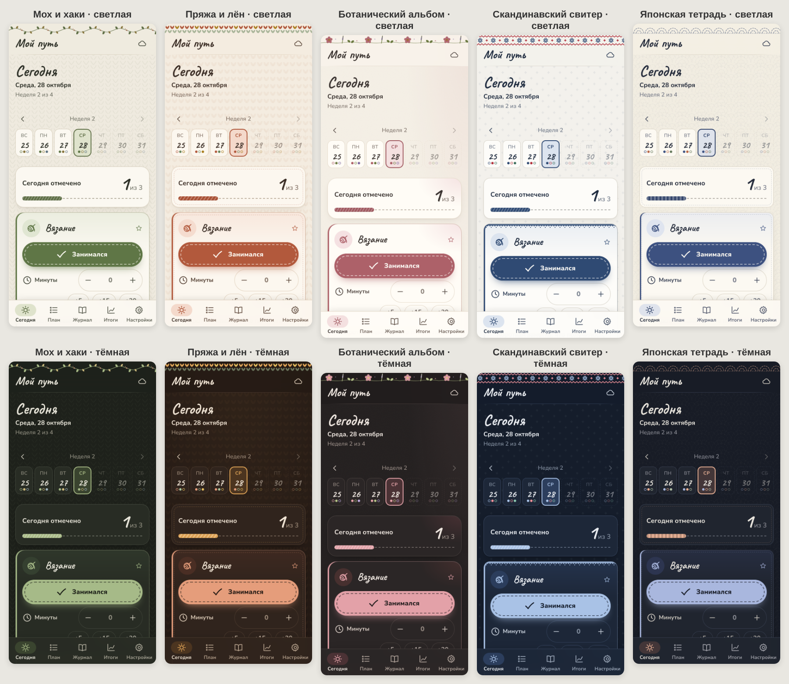

# Трекер обучения

Личный трекер для параллельного освоения навыков. По умолчанию это вязание, английский и письмо левой рукой, а навыки можно переименовывать, добавлять и удалять.

- **Сегодня**: отметка «занимался», минуты и короткая заметка по каждому навыку, серии по правилу «не пропускать дважды», отметки за прошедшие дни.
- **План**: недели с заданиями. Задания можно отмечать, редактировать, добавлять, удалять и переносить. План можно продлить.
- **Журнал**: итоги каждой недели. Показатели со сравнением «было → стало», чек-листы приёмов и тем (отмеченное переносится дальше), заметки.
- **Итоги**: статистика, календарь занятий, графики показателей, промежуточные и итоговые отчёты.
- **Настройки**: пять вариантов оформления (светлая и тёмная тема у каждого), дата старта, длина плана, навыки, вход в аккаунт, резервная копия.



Приложение работает и без интернета. Без настройки облака данные хранятся только на одном устройстве. Чтобы данные совпадали на телефоне и компьютере, один раз выполните шаги ниже. Всё бесплатно.

---

## 1. Создайте бесплатный проект Firebase (облако для синхронизации)

1. Откройте <https://console.firebase.google.com> и войдите со своим Google-аккаунтом.
2. Нажмите **«Создать проект»** (Create a project). Название любое, например `learning-tracker`. Google Analytics **отключите**: он не нужен.
3. Тариф остаётся бесплатным (Spark). Карту привязывать не нужно.

### Включите вход в аккаунт
1. Слева выберите **Build → Authentication → Get started**.
2. На вкладке **Sign-in method** включите:
   - **Google**: нажмите, включите переключатель, укажите свою почту поддержки, нажмите **Save**;
   - **Email/Password**: нажмите, включите **второй** переключатель **Email link (passwordless sign-in)**, нажмите **Save**.
3. На вкладке **Settings → Authorized domains** нажмите **Add domain** и добавьте адрес вашего сайта: `scvals.github.io`. Без этого вход с сайта не сработает.

### Создайте базу данных
1. Слева выберите **Build → Firestore Database → Create database**.
2. Расположение (location) любое, например `eur3 (Europe)`. Режим: **Production mode**.
3. Откройте вкладку **Rules**, удалите всё, что там написано, вставьте содержимое файла [`firestore.rules`](firestore.rules) из этого репозитория и нажмите **Publish**. Эти правила разрешают видеть и менять данные только вам.

### Получите ключи
1. Нажмите на шестерёнку рядом с **Project Overview** → **Project settings**.
2. Внизу, в блоке **Your apps**, нажмите на значок **`</>`** (Web).
3. Введите любое имя, галочку Hosting **не ставьте**, нажмите **Register app**.
4. Появится код с `const firebaseConfig = { ... }`. Скопируйте всё, что внутри фигурных скобок.

> Эти «ключи» не секретные: они только указывают приложению, куда подключаться. Ваши данные защищают правила доступа из шага выше.

## 2. Вставьте ключи

1. В репозитории на GitHub откройте файл **`js/firebase-config.js`** и нажмите на карандаш (**Edit**).
2. Замените строку `export const firebaseConfig = null;` на скопированное, например:

   ```js
   export const firebaseConfig = {
     apiKey: "AIza...",
     authDomain: "learning-tracker-xxxx.firebaseapp.com",
     projectId: "learning-tracker-xxxx",
     storageBucket: "learning-tracker-xxxx.appspot.com",
     messagingSenderId: "1234567890",
     appId: "1:1234567890:web:abcdef"
   };
   ```
3. Нажмите **Commit changes**. Через 1–2 минуты сайт обновится сам.

## 3. Публикация сайта (GitHub Pages)

Сайт публикуется автоматически при каждом изменении в ветке `main`. Если он ещё не открывается:

1. В репозитории откройте **Settings → Pages**.
2. В поле **Source** выберите **GitHub Actions**.
3. Откройте вкладку **Actions** и дождитесь зелёной галочки у задачи «Публикация на GitHub Pages».

Адрес сайта: **<https://scvals.github.io/learning-tracker/>**

## 4. Вход и синхронизация

1. Откройте сайт → **Настройки → Аккаунт и синхронизация**.
2. Нажмите **«Войти через Google»** или введите почту и нажмите **«Войти по ссылке на email»**. Во втором случае придёт письмо: откройте ссылку из него **на том же устройстве**.
3. Повторите вход на втором устройстве **с тем же аккаунтом**. Данные подтянутся сами.

Значок облака в правом верхнем углу показывает состояние: синхронизировано, идёт синхронизация, нет сети (изменения сохранятся и отправятся позже) или «только на этом устройстве».

Если одно и то же изменили на двух устройствах, сохранится более позднее изменение.

## 5. Добавьте на главный экран телефона

- **Android (Chrome)**: откройте сайт → меню **⋮** → **«Добавить на главный экран»** (или **«Установить приложение»**).
- **iPhone (Safari)**: откройте сайт → кнопка **«Поделиться»** (квадрат со стрелкой) → **«На экран „Домой“»**.

После этого трекер открывается как обычное приложение и работает без интернета.

> На iPhone вход через Google удобнее делать в Safari до добавления на экран «Домой». Если в установленном приложении вход не проходит, используйте вход по ссылке на email.

## Резервная копия

**Настройки → Резервная копия**:

- **«Скачать резервную копию»** сохраняет файл `.json` со всеми данными. В файле указана версия схемы данных.
- **«Загрузить из файла»** восстанавливает данные из такого файла. Перед заменой текущих данных трекер спросит подтверждение.
- **«Очистить все данные»** возвращает исходный план.

Время от времени сохраняйте копию, например в конце каждой недели.

---

## Для разработчика

- Стек: HTML, CSS и JavaScript (ES-модули) без сборки и зависимостей. Firebase подгружается с CDN, только если указаны ключи.
- Запуск локально: `python3 -m http.server` в папке проекта, затем открыть <http://localhost:8000>.
- Тесты: `node --test tests/*.test.mjs` (или `npm test`).
- Устройство кода и формат данных описаны в [`CONTRACT.md`](CONTRACT.md).
- После изменения файлов увеличьте `VERSION` в `sw.js`, чтобы установленное приложение получило обновление.
